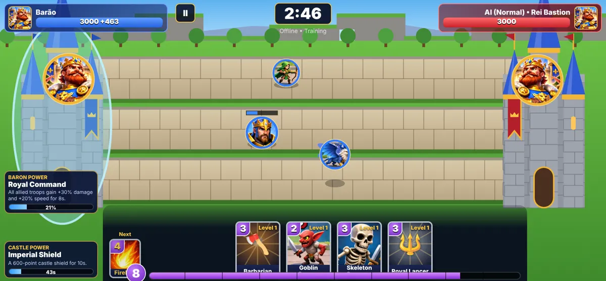

# BASTION BARONS

Jogo de **estratégia em tempo real + batalha de cartas** em fantasia medieval para celular (Android). Ele é feito em **HTML5 Canvas + JavaScript** e empacotado como app Android nativo (WebView), do mesmo jeito que o Rift Rumble.

**Baixar o APK:** [último Release](https://github.com/transcendenteuniversal-lang/bastion-barons/releases/latest) → `BastionBarons.apk`



### Atualização automática
A cada push que muda o jogo, o GitHub Actions (`.github/workflows/apk.yml`) roda os testes, compila o APK e publica um Release novo (`v<número>`). Ao abrir, o app consulta o último Release. Se houver versão mais nova, ele mostra **Nova versão → Atualizar**, que baixa o APK. Basta tocar no arquivo para instalar por cima (a assinatura é sempre a mesma, e o progresso é mantido).

## Como jogar
- Arraste uma carta até uma das **3 rotas** (ou toque na carta e depois na rota). As tropas avançam e lutam sozinhas.
- Cada carta gasta **energia**, que recarrega com o tempo e **dobra no último minuto**.
- O **Barão** fica no seu castelo, não pode ser atacado e tem um **poder** que carrega com o tempo. O **castelo** também tem um poder próprio. Os dois botões ficam no canto inferior esquerdo.
- Para vencer, destrua o castelo inimigo. Se o tempo (3 min) acabar, vence quem tiver mais vida no castelo. Se empatar, vence quem destruiu mais tropas.

## O que já existe (offline contra IA)
| Sistema | Detalhes |
|---|---|
| Cartas | 32 (24 tropas + 8 feitiços), 5 raridades, habilidades: área, aura, invocação, renascimento, lentidão, regeneração, cura, torre, "só castelos" |
| Barões | Rei Bastion (Comando Real), Elara (Chuva Élfica), Thorg (Fúria Orc), Malachar (Exército dos Mortos), Eldrin (Tempestade Arcana) |
| Castelos | Fortaleza Real (Escudo Imperial), Fortaleza Glacial (Tempestade de Gelo), Castelo Dracônico (Sopro do Dragão) |
| IA | Fácil, Normal, Difícil. A dificuldade muda só as decisões, nunca os atributos (a Difícil venceu a Fácil em 19 de 20 partidas no teste) |
| Progressão | XP e nível de conta, desbloqueio de Barões e castelos, ouro, evolução de cartas, carta por vitória com chances visíveis e proteção contra azar |
| Telas | Abertura, menu, modos, Barões, castelos, coleção (filtros e busca), detalhe e evolução da carta, 3 baralhos, batalha, pausa, resultado, histórico, configurações |
| Outros | Português e inglês, música e sons originais gerados pelo jogo, vibração, progresso salvo no aparelho |

Ainda não feito: PvP online, contas, loja e compras, baús, missões, passe, clãs, painel admin, espanhol, francês e alemão. Detalhes em [`docs/STATUS.md`](docs/STATUS.md).

## Estrutura
```
web/            o jogo (abre direto no navegador: web/index.html)
  js/data.js      cartas, Barões, castelos e balanceamento (edite aqui para rebalancear)
  js/strings.js   textos em pt e en
  js/sim.js       regras da partida (sem desenho; roda também no Node e no futuro servidor)
  js/ai.js        IA
  js/progress.js  perfil, progressão e economia
  js/render.js    desenho do campo, castelos, Barões, tropas e efeitos
  js/battle.js    laço da batalha, toque/arraste e HUD
  js/ui.js        menus
  js/audio.js     música e efeitos gerados
  js/update.js    atualização automática pelo GitHub Releases
android/        app Android (WebView), ícones e chave de assinatura de desenvolvimento
art/source/     arte original enviada (logo, ícone, banner, mockups)
tools/          prepare-art.py (recorta a arte), build-apk.sh, sim-test.js, browser-test.js
docs/           status, arquitetura, design, ativos, build, privacidade
```

## Testar
```bash
node tools/sim-test.js                    # 37 testes das regras
node tools/browser-test.js screenshots    # joga no navegador (Playwright) e tira capturas
./tools/build-apk.sh                      # gera release/BastionBarons.apk
```
No computador, também dá para abrir `web/index.html` no navegador e jogar com o mouse.

---
BASTION BARONS é uma propriedade intelectual original.
