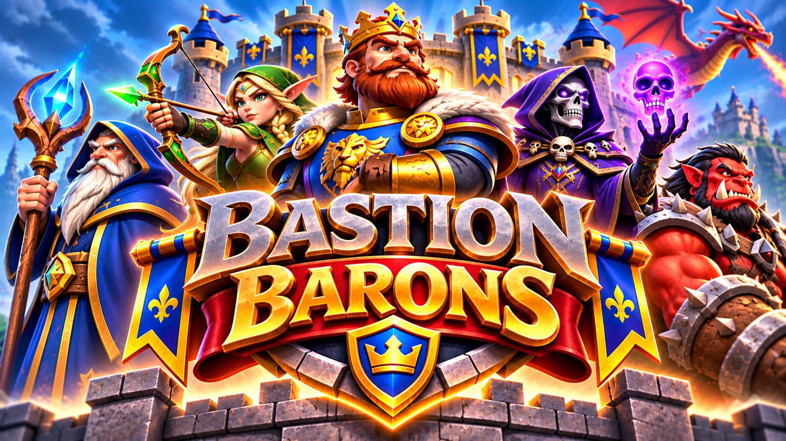

# BASTION BARONS

Jogo mobile de **estratégia em tempo real + batalha de cartas** em fantasia medieval. Dois castelos, três rotas horizontais, tropas que avançam sozinhas, feitiços, um **Barão** comandante ao lado de cada castelo e **poderes de castelo**.

- **Motor:** Unity 6 (C#), plataforma inicial Android
- **Status:** Fases 1 a 4 jogáveis offline contra IA, sem PvP online. Ver [`docs/STATUS.md`](docs/STATUS.md).
- **Idiomas:** Português (Brasil) e Inglês. Espanhol, Francês e Alemão estão planejados.



## O que já funciona (offline)

| Sistema | Detalhes |
|---|---|
| Batalha | 3 rotas, 2 castelos, tropas terrestres e voadoras, combate automático, partidas de 3 min, energia em dobro no último minuto, desempate definido |
| Cartas | 32 cartas (24 tropas + 8 feitiços), 5 raridades, baralho de 14, mão de 4 com a próxima carta visível |
| Barões | Rei Bastion, Elara, Thorg, Malachar e Eldrin. O poder carrega com o tempo e é ativado manualmente. O Barão fica no castelo e não pode ser atacado |
| Castelos | Fortaleza Real (Escudo Imperial), Fortaleza Glacial (Tempestade de Gelo), Castelo Dracônico (Sopro do Dragão) |
| IA | Fácil, Normal e Difícil. A dificuldade muda só a qualidade das decisões, nunca os atributos |
| Progressão | XP e nível de conta, desbloqueio de Barões e castelos, ouro, evolução de cartas (cópias + ouro), recompensa de carta por vitória com chances visíveis e proteção contra azar |
| Coleção | Filtros por raridade, tipo, classe e custo, busca por nome, detalhes, evolução |
| Baralho | 3 baralhos salvos, validação (14 cartas únicas que o jogador possui) |
| Telas | Abertura, menu, modos, Barões, castelos, coleção, detalhe da carta, baralho, batalha, pausa, resultado, histórico e configurações (áudio, gráficos, idioma, nome, privacidade, créditos, apagar progresso) |
| Salvamento | Perfil local em JSON com escrita atômica e reparo de saves corrompidos |
| Testes | 34 testes EditMode (NUnit) cobrindo combate, energia, baralho, Barões, castelos, vitória/derrota, determinismo, IA e progressão |

## Como abrir e jogar

1. Instale o **Unity 6** (6000.0 LTS) com o módulo **Android Build Support**.
2. Abra esta pasta no Unity Hub. Na primeira abertura, o script `ProjectSetup` cria a cena `Assets/Scenes/Main.unity`, os materiais base, o ícone e as configurações Android.
3. Pressione **Play**. O jogo é montado inteiro por código, sem precisar de prefabs.
4. Para rodar os testes, abra **Window → General → Test Runner → EditMode → Run All**.
5. Para gerar os builds, use **Bastion Barons → Build → Android APK (teste)** ou **Android AAB (Google Play)**. Detalhes em [`docs/BUILD.md`](docs/BUILD.md).

## Estrutura

```
Assets/BastionBarons/
  Scripts/Core/     Simulação pura em C#, sem Unity (partida, cartas, IA, progressão). Reutilizável no servidor
  Scripts/Game/     Cliente Unity: telas, HUD, visual 3D, áudio, salvamento, localização
  Scripts/Editor/   Configuração automática do projeto e builds Android
  Resources/Data/   content.json: cartas, Barões, castelos e balanceamento (ajustável sem mexer no código)
  Resources/Localization/  Tabelas de texto (pt-BR, en)
  Resources/Art/    Logo, ícone e fundo oficiais
  Tests/EditMode/   Testes automatizados
Art/Reference/      Artes de referência (mockup da batalha, visão geral das telas)
Marketing/          Material de loja e divulgação
docs/               Status, arquitetura, design, ativos, build e privacidade
```

## Documentação

- [`docs/STATUS.md`](docs/STATUS.md): o que está pronto, o que falta, testes, dependências e credenciais
- [`docs/ARCHITECTURE.md`](docs/ARCHITECTURE.md): módulos, fluxo da simulação e plano do servidor autoritativo
- [`docs/GAME_DESIGN.md`](docs/GAME_DESIGN.md): regras e números de balanceamento
- [`docs/ASSETS.md`](docs/ASSETS.md): arte e áudio provisórios e onde substituí-los
- [`docs/BUILD.md`](docs/BUILD.md): compilação, assinatura, APK, AAB e CI
- [`docs/PRIVACY.md`](docs/PRIVACY.md): rascunho da política de privacidade (LGPD)

---
BASTION BARONS é uma propriedade intelectual original. Nenhum personagem, carta, nome ou interface foi copiado de outros jogos.
