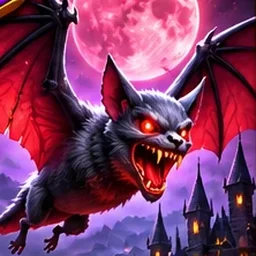
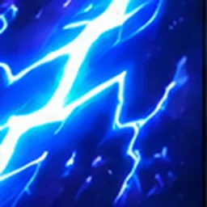
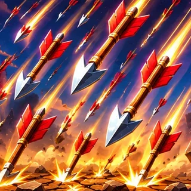
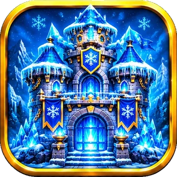
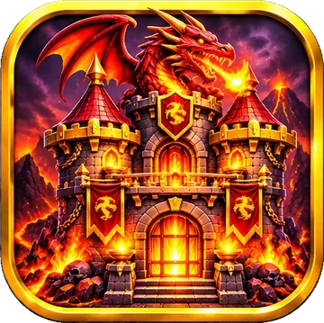

# Cartas — Bastion Barons

**DPS** = dano por segundo (dano ÷ intervalo entre ataques). **Velocidade** = unidades andadas por segundo. A rota mede 100 unidades (88 entre as frentes dos castelos); o alcance usa a mesma medida (1,5 = corpo a corpo).

## Tropas e criaturas (31)

| # | Carta | Na arena | Nome | Papel | Raridade | Voa | Custo | Vida | Dano | Intervalo | DPS | Velocidade | Alcance | Ataca | Habilidade | Descrição |
|---|---|---|---|---|---|---|---|---|---|---|---|---|---|---|---|---|---|
| 1 |  | — | **Trio de Esqueletos** | Ciclo | Comum | Não | 1 | 95 | 40 | 1 s | 40 | 4,2 | 1,5 | Terra | — | Três esqueletos baratos para segurar o avanço e ciclar o baralho. |
| 2 |  |  | **Arqueiro Real** | Atirador | Comum | Não | 2 | 260 | 40 | 1 s | 40 | 3,5 | 30 | Terra e ar | — | Arqueiro de longuíssimo alcance. |
| 3 |  |  | **Atirador Goblin** | Atirador | Comum | Não | 2 | 220 | 35 | 0,5 s | 70 | 4,2 | 10 | Terra e ar | Ataca 2 vezes por segundo | Atira duas vezes por segundo. |
| 4 |  | — | **Enxame de Morcegos** | Ciclo | Rara | Sim | 2 | 90 | 38 | 1 s | 38 | 5,95 | 1,5 | Terra e ar | — | Três morcegos rápidos e frágeis que voam por cima das tropas. |
| 5 |  |  | **Morcego Vampírico** | Voador | Rara | Sim | 2 | 230 | 75 | 1 s | 75 | 5,95 | 1,5 | Terra e ar | Roubo de vida: recupera 30% do dano causado | Voador muito rápido; recupera 30% do dano causado. |
| 6 |  |  | **Arqueiro Élfico** | Atirador | Rara | Não | 3 | 300 | 70 | 1 s | 70 | 3,5 | 20 | Terra e ar | Muda para a rota vizinha uma vez, quando um inimigo chega a 10 de distância | Longo alcance; muda de rota uma vez quando um inimigo chega perto. |
| 7 |  |  | **Assassino Sombrio** | Pressão | Épica | Não | 3 | 320 | 175 | 1 s | 175 | 8 | 1,5 | Terra | — | Velocíssimo, com ataques letais. |
| 8 |  |  | **Bárbaro** | Corpo a corpo | Comum | Não | 3 | 600 | 110 | 1 s | 110 | 3,85 | 1,5 | Terra | — | Golpes corpo a corpo devastadores. |
| 9 |  |  | **Cavaleiro Real** | Linha de frente | Comum | Não | 3 | 700 | 75 | 1 s | 75 | 3,5 | 1,5 | Terra | Cada golpe empurra o inimigo 3 casas para trás | Cada golpe empurra o inimigo 3 casas para trás. |
| 10 |  |  | **Clériga Real** | Suporte | Rara | Não | 3 | 380 | 25 | 1 s | 25 | 3,15 | 6 | Terra e ar | Cura 50 de vida nos aliados num raio de 7, a cada 2 s | Cura aliados próximos a cada 2 segundos. |
| 11 |  |  | **Lanceiro Real** | Anti-aéreo | Comum | Não | 3 | 520 | 71 | 1 s | 71 | 3,5 | 3 | Terra e ar | — | Alcance intermediário; atinge alvos aéreos. |
| 12 |  |  | **Druida da Floresta** | Suporte | Épica | Não | 4 | 480 | 79 | 1 s | 79 | 3,15 | 7 | Terra | Cura 75 de vida nos aliados num raio de 8, a cada 3 s | Cura aliados próximos periodicamente. |
| 13 |  |  | **Duende da Balista** | Artilharia | Rara | Não | 4 | 380 | 150 | 2 s | 75 | 2,8 | 60 | Terra | — | Duende vermelho com uma balista: tiros lentos e fortes de altíssimo alcance (só alvos em terra). |
| 14 |  |  | **Engenheiro Anão** | Construção | Épica | Não | 4 | 400 | 40 | 1 s | 40 | 2,8 | 3 | Terra | Ao entrar, constrói 1 Torre Anã | Constrói uma torre de defesa ao entrar em campo. |
| 15 |  |  | **Feiticeira Sombria** | Dano em área | Épica | Não | 4 | 380 | 60 | 1 s | 60 | 3,15 | 10 | Terra e ar | Dano em área (raio 4) | Magia sombria em grande área. |
| 16 |  |  | **Grifo Real** | Pressão | Rara | Não | 4 | 620 | 95 | 1 s | 95 | 4,9 | 1,5 | Terra e ar | Pode entrar em qualquer ponto da rota | Pode ser invocado em qualquer ponto das rotas. |
| 17 |  |  | **Guerreiro Anão** | Dano em área | Comum | Não | 4 | 850 | 80 | 1 s | 80 | 2,8 | 1,5 | Terra | Dano em área (raio 3) | Golpes pesados que atingem uma área. |
| 18 |  |  | **Invocador de Esqueletos** | Invocador | Épica | Não | 4 | 560 | 60 | 1 s | 60 | 3,15 | 8 | Terra | Invoca 3 Esqueletos a cada 9 s | Invoca 3 esqueletos a cada 9 segundos. |
| 19 |  |  | **Lobo de Guerra** | Pressão | Comum | Não | 4 | 340 | 85 | 1 s | 85 | 5,25 | 1,5 | Terra | Entram 3, um em cada rota | Entram 3 lobos, um em cada rota. |
| 20 |  |  | **Mago Arcano** | Dano em área | Épica | Não | 4 | 340 | 75 | 1 s | 75 | 3,15 | 11 | Terra e ar | Dano em área (raio 2,5) | Dano mágico em pequena área. |
| 21 |  |  | **Necromante** | Invocador | Lendária | Não | 4 | 420 | 38 | 1 s | 38 | 2,8 | 10 | Terra e ar | Toda unidade que morre na rota vira esqueleto do seu lado | Toda unidade que morre na rota volta como esqueleto do seu lado. |
| 22 |  |  | **Orc Vermelho** | Linha de frente | Rara | Não | 4 | 900 | 73 | 1 s | 73 | 3,15 | 1,5 | Terra | Com 50% da vida ou menos, ataca e anda 2× mais rápido | Com metade da vida ou menos, ataca e anda duas vezes mais rápido. |
| 23 |  |  | **Dragão de Gelo** | Voador | Épica | Sim | 5 | 1050 | 50 | 1 s | 50 | 2,8 | 3 | Terra e ar | Cada ataque congela o alvo por 1,5 s | Aéreo; cada ataque congela o alvo por 1,5 s. |
| 24 |  |  | **Fênix** | Voador | Mítica | Sim | 5 | 700 | 75 | 1 s | 75 | 3,85 | 5 | Terra e ar | Renasce uma vez no começo da rota, 50% maior e com 2× de dano | Aérea; renasce uma vez no começo da rota, 50% maior e com o dobro de dano. |
| 25 |  |  | **Guardião de Pedra** | Tanque | Rara | Não | 5 | 1750 | 33 | 1 s | 33 | 2,1 | 1,5 | Terra | Cresce e ganha +10% de dano a cada inimigo abatido na rota | Cresce e fica 10% mais forte a cada inimigo abatido na rota. |
| 26 |  |  | **Paladino** | Suporte | Rara | Não | 5 | 650 | 50 | 1 s | 50 | 3,15 | 1,5 | Terra | Cúpula: aliados num raio de 5 só levam dano de inimigos dentro dela | Cúpula protetora: aliados próximos só levam dano de inimigos dentro dela. |
| 27 |  |  | **Troll das Montanhas** | Tanque | Rara | Não | 5 | 1350 | 81 | 1 s | 81 | 2,45 | 1,5 | Terra | O primeiro golpe arremessa o inimigo 20 casas para trás | O primeiro golpe arremessa o inimigo 20 casas para trás. |
| 28 |  |  | **Dragão de Fogo** | Voador | Lendária | Sim | 6 | 1100 | 73 | 1 s | 73 | 2,8 | 20 | Terra e ar | Dano em área (raio 3) | Aéreo; sopro de fogo em área de longo alcance. |
| 29 |  |  | **Ent Guardião** | Tanque | Épica | Não | 6 | 1800 | 50 | 1 s | 50 | 1,75 | 1,5 | Terra | Regenera 25 de vida por segundo | Regenera vida continuamente. |
| 30 |  |  | **Demônio Infernal** | Vencedor de jogo | Mítica | Não | 7 | 1250 | 147 | 1 s | 147 | 2,8 | 1,5 | Terra | Ao entrar, os inimigos da rota viram esqueletos; se ele morrer, voltam ao normal | Ao entrar, os inimigos da rota viram esqueletos enquanto ele viver. |
| 31 |  |  | **Golem de Pedra** | Cerco | Épica | Não | 7 | 3200 | 180 | 2 s | 90 | 1,75 | 1,5 | Só castelo | — | Tanque colossal que só ataca castelos. |

## Magias (9)

| # | Carta | Na arena | Nome | Papel | Raridade | Custo | Efeito | Dano no castelo | Descrição |
|---|---|---|---|---|---|---|---|---|---|
| 1 |  | — | **Faísca** | Ciclo | Comum | 2 | 190 de dano num raio de 3 e atordoa por 0,6 s | 30% do dano | Pequena descarga: 190 de dano em área e atordoa por um instante. |
| 2 |  |  | **Chuva de Flechas** | Feitiço de dano | Comum | 3 | 200 de dano nos inimigos em toda a rota | 20% do dano | Dano em todos os inimigos da rota. |
| 3 |  |  | **Congelamento** | Controle | Épica | 3 | Paralisa os inimigos num raio de 6 por 4 s | — | Paralisa inimigos na área por 4 segundos. |
| 4 |  |  | **Cura Divina** | Suporte | Rara | 3 | Cura 500 de vida das suas tropas em toda a rota | — | Cura todas as suas tropas na rota. |
| 5 |  |  | **Escudo Arcano** | Suporte | Rara | 3 | Escudo de 250 nas suas tropas em toda a rota por 8 s | — | Escudo de 300 em todas as suas tropas da rota. |
| 6 |  |  | **Invocação Esquelética** | Invocador | Comum | 3 | Invoca 5 Esqueletos | — | Invoca 5 esqueletos temporários. |
| 7 |  |  | **Veneno** | Feitiço de dano | Rara | 3 | 80 de dano por segundo num raio de 5 por 6 s | — | Dano contínuo por 6 segundos. |
| 8 |  |  | **Bola de Fogo** | Feitiço de dano | Comum | 4 | 350 de dano nos inimigos num raio de 4 | 30% do dano | Dano em área na frente inimiga; atinge castelos. |
| 9 |  |  | **Relâmpago** | Anti-tanque | Épica | 5 | 650 de dano em cada um dos 3 inimigos mais fortes da rota | 25% do dano | Atinge os 3 inimigos mais fortes da rota. |

## Invocadas (não colecionáveis) (2)

| # | Carta | Na arena | Nome | Papel | Raridade | Voa | Custo | Vida | Dano | Intervalo | DPS | Velocidade | Alcance | Ataca | Habilidade | Descrição |
|---|---|---|---|---|---|---|---|---|---|---|---|---|---|---|---|---|---|
| 1 |  |  | **Esqueleto** | Invocada | Comum | Não | 1 | 120 | 40 | 1 s | 40 | 4,2 | 1,5 | Terra | — | Unidade temporária invocada. |
| 2 | — |  | **Torre Anã** | Invocada | Comum | Não | 1 | 700 | 67 | 1 s | 67 | 0 | 13 | Terra e ar | — | Torre temporária de longo alcance. |

## Barões

| Foto | Barão | Poder | Recarga | Efeito |
|---|---|---|---|---|
|  | **Rei Bastion** | Comando Real | 35 s | Todas as tropas aliadas ganham +30% de dano e +20% de velocidade por 8s. |
|  | **Elara** | Chuva Élfica | 30 s | 8 rajadas de flechas, 55 de dano cada (440 no total), em todos os inimigos da rota escolhida. |
|  | **Thorg** | Fúria Orc | 30 s | A rota fica em chamas: tropas aliadas nela ganham +60% de dano e +25% de velocidade de ataque por 8s. |
|  | **Malachar** | Exército dos Mortos | 35 s | Invoca 5 esqueletos na rota escolhida. |
|  | **Eldrin** | Tempestade Arcana | 40 s | Congela todos os inimigos da rota escolhida por 4 segundos. |

## Castelos

| Foto | Castelo | Poder | Recarga (1ª vez) | Efeito |
|---|---|---|---|---|
|  | **Fortaleza Real** | Escudo Imperial | 50 s (20 s) | Escudo de 600 pontos no castelo por 10s. |
|  | **Fortaleza Glacial** | Tempestade de Gelo | 50 s (20 s) | Inimigos da rota ficam 50% mais lentos por 6s. |
|  | **Castelo Dracônico** | Sopro do Dragão | 50 s (20 s) | 300 de dano em todos os inimigos da rota. |
|  | **Santuário Silvestre** | Bênção da Floresta | 50 s (20 s) | Cura 350 do castelo e 30% da vida de todas as suas tropas. |
|  | **Necrópole Sombria** | Dreno de Almas | 50 s (20 s) | 220 de dano nos inimigos da rota; o castelo recupera 60% do dano causado. |

## Regras gerais

- Vida do castelo: 6000. A torre do castelo atira 0 de dano a cada 1 s, alcance 16.
- Partida de 180 s. Baralho de 14 cartas, mão de até 6, compra uma carta a cada 4 s.
- Mana: começa em 1; o máximo começa em 3 e sobe +1 a cada 6,5 s até 10. Enche 0,43 por segundo, acelera até +75% em 90 s, e no último minuto fica ×1,75.
- Cada nível da carta dá +8% de vida e dano (nível máximo 10).
- Velocidade de todas as tropas multiplicada por 0,7 (já aplicado na tabela).
